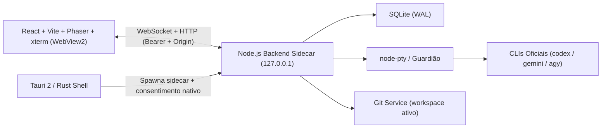

# AI Dev World (v1.0.0)

Aplicativo desktop **local-first** para desenvolvimento supervisionado por agentes de IA. Cada agente atua como personagem em um escritório 2D interativo (Phaser) e executa um **CLI oficial já instalado e autenticado por você**. O aplicativo não usa chaves de API próprias: ele orquestra os CLIs locais sob aprovações humanas explícitas.

> **Versão 1.0.0 (Windows x64):** empacotado com Tauri 2 e instalador NSIS (`currentUser`). **Distribuído sem assinatura digital** (sem certificado de code signing — o Windows SmartScreen pode exibir aviso na instalação). Uso dos modelos depende das contas, cotas e condições dos respectivos provedores.

---

## Integrações realmente disponíveis

| CLI | Comando | Uso no app |
| --- | --- | --- |
| Codex CLI | `codex` | Execução headless (`codex exec`) e terminal interativo |
| Gemini CLI | `gemini` | Execução headless e terminal interativo |
| Google Antigravity CLI | `agy` | Execução headless (`agy -p`) e terminal interativo |

**Claude Code não é um provedor integrado.** Nenhum outro provedor é suportado hoje.

Agentes padrão: **Arquiteto** (Tech Lead / planejamento), **Dev** (implementação), **QA** (revisão de código e evidências) e **Tutor**. O provedor, o modelo e o esforço de cada um são configurados na Central de Agentes. Também é possível criar agentes personalizados com especializações.

> **Sobre o QA:** o agente de QA realiza inspeção estática de código e evidências. A Observabilidade identifica quando os testes não foram executados pelo sistema (`tests.executed: unavailable` / `staticReviewOnly: true`). A execução autônoma de testes reais pelo QA ainda não está comprovada na versão 1.0.

---

## Recursos principais

- **Escritório 2D interativo (Phaser):** agentes com estado ao vivo (planejando, executando, revisando, aguardando aprovação), dock de agentes, terminal inferior integrado (`Ctrl+J`) e objetos clicáveis.
- **Central da Equipe:** gestão unificada de **Agentes** (padrão e personalizados com especializações e avatares), **Skills** (biblioteca com importação Markdown desativada por padrão) e **Memória** (escopo por projeto ou equipe, com consentimento nativo).
- **Gerenciamento de tarefas e missões:** modos Clássico e Dinâmico (delegação estruturada pelo Tech Lead com aprovação humana a cada proposta, ajuste ou replanejamento).
- **Terminal integrado:** sessões PTY reais (`node-pty`) do CLI de cada agente e abas de shell pessoal no dock inferior (`Ctrl+J`), sempre na pasta do projeto ativo.
- **Painel Git:** visualização de status, diff, staging, commit e push com pré-visualização.
- **Observabilidade e histórico:** trilha de eventos por missão com classificação de evidência (`observed`, `declared`, `unavailable`).
- **Controle de permissões e segurança:** consentimento nativo no Tauri para operações sensíveis de memória (`memory-approve`) e decisões de missão (`proposal-decide`, `mission-close`) via nonce de uso único vinculado à operação, remoção de segredos e conferência SHA-256 contra escritas não autorizadas.
- **Recuperação de missões:** retomada segura após fechamento ou queda do app.

## Arquitetura

- **Desktop Shell:** Tauri 2 + Rust (gerenciamento de janela, diálogos nativos de confirmação, segredo interno de desktop e supervisão de sidecar via Job Object no Windows).
- **Interface:** React 19, TypeScript, Vite, Phaser 3 e `@xterm/xterm`.
- **Backend local:** Node.js (sidecar empacotado), servidor HTTP + WebSocket (`ws`) em `127.0.0.1`, `node-pty`.
- **Persistência:** SQLite em modo WAL (`data.sqlite`).
- **Execução de agentes:** CLIs externas (`codex`, `gemini`, `agy`).



## Chat com o Tech Lead (entrada principal)

Ao abrir o app, a aba **Chat** mostra as conversas do projeto ativo. Você pode conversar com o Tech Lead, ou com outro agente planejador ativo, sobre ideias, requisitos, arquitetura e planejamento.

- **Conversar não executa nada.** O agente roda com o papel de planejamento, sem permissão de escrita e sob o supervisor de processos. Nenhuma resposta vira proposta, aprovação ou missão por conta própria. Frases como "pode fazer" ou "aprovado" na conversa não autorizam nada.
- As conversas ficam no SQLite, separadas por projeto: uma conversa não é vista nem usada a partir de outro projeto. Elas podem ser renomeadas e excluídas (com confirmação).
- **Contexto limitado:** cada resposta recebe só as mensagens mais recentes (até 20 e 16 mil caracteres). Quando mensagens antigas ficam de fora, a resposta avisa.
- Uma resposta por vez no app. **Interromper** encerra o processo do CLI. Se o app fechar no meio, a resposta fica como interrompida e nada é relançado.
- Sem CLI disponível, as conversas continuam consultáveis.
- O texto mostrado e o gravado passam pela remoção de segredos. O app só publica a saída do CLI após sucesso, pois uma falha pode repetir o prompt. A interface renderiza Markdown sem HTML: links só abrem se forem `http(s)`.
- Se arquivos mudarem durante uma resposta, ela é marcada com erro e aviso. Nada é desfeito.

### Da conversa para a missão

O botão **▶ Preparar missão**, no cabeçalho da conversa, transforma a conversa numa **missão dinâmica**. Antes de criar, o app pede confirmação.

- O backend cria a tarefa e a missão, e o Tech Lead recebe as mensagens mais recentes da conversa como **contexto, não como ordens**: até 12 mensagens, 6 mil caracteres no total e 1.500 por mensagem. Pedidos na conversa para ignorar regras, ampliar permissões ou fazer commit/push não valem e vão para os riscos da proposta.
- A proposta passa pela mesma validação e pela mesma **aprovação humana** do modo dinâmico. Você aprova, ajusta ou rejeita no próprio chat ou em **Tarefas**. Nada é executado antes disso.
- A conversa mostra um card por missão vinculada, com o estado ("Aguardando sua aprovação", "Executando passos aprovados", "Concluída"…). Se a missão estiver aberta, o monitor dinâmico aparece dentro do card. O card também tem atalhos para **Tarefas** e para a trilha de eventos.
- Em **Tarefas**, a missão mostra "Origem: conversa #N" e o botão **← Voltar ao chat**.
- Uma missão aberta por conversa. O botão também fica desligado sem conexão, sem mensagem sua na conversa, durante uma resposta do Tech Lead ou com o CLI dele indisponível. O backend refaz todas essas checagens.
- A trilha registra `chat.mission_requested` e `chat.mission_linked`.

## Modos de missão

### Clássico
Uma equipe fixa trabalha em sequência: **planejamento → aprovação humana do plano → desenvolvimento → revisão do QA**. Quando o QA reprova, o trabalho volta ao Dev até um limite de tentativas.

### Dinâmico (Tech Lead)
O Tech Lead propõe a equipe e os passos (análise, implementação, revisão, verificação) num formato estruturado que o **backend valida** (formato, revisão vigente, membros, permissões por categoria, dependências e limites). Nada roda sem a sua decisão:

- **Aprovar**, **rejeitar** ou **pedir ajustes** em cada proposta. A decisão vale só para a revisão que você viu.
- Quando um passo falha, é reprovado ou fica bloqueado, o Tech Lead é consultado de novo e a nova proposta também aguarda você.
- Limites por missão: passos, turnos do Tech Lead, mudanças de equipe, retrabalho e chamadas por agente.

Pode consumir mais chamadas aos CLIs que o modo clássico.

## Recuperação

Se o app fechar durante uma missão dinâmica, ela fica **parada aguardando decisão**: nenhum CLI é relançado sozinho. O painel de recuperação mostra os passos interrompidos e as alterações no Git. Ele também oferece continuar, reexecutar um passo, pedir replanejamento, encerrar ou cancelar.

Cada arquivo registrado pela missão guarda uma impressão SHA-256. Se ele mudar por fora, ou se a missão for antiga e não tiver impressão, a próxima escrita só acontece depois da sua confirmação. **A confirmação vale exatamente para a lista exibida:** se surgir outra alteração depois disso, o backend recusa e pede uma nova confirmação. Nada é desfeito no repositório.

Missões clássicas interrompidas são marcadas como falhas, e a tarefa volta para "a fazer".

---

## Requisitos

### Para uso via instalador Windows (v1.0.0)
- **Windows 10 ou Windows 11 (x64)**.
- **Microsoft Edge WebView2 Runtime** (caso ausente, o instalador inclui bootstrapper para download automático).
- **Git** disponível no `PATH`.
- Pelo menos uma CLI oficial instalada e autenticada (`codex`, `gemini` ou `agy`). O uso, limites e eventual cobrança dependem exclusivamente da sua conta e das condições de cada provedor.

### Para desenvolvimento a partir do código-fonte
- **Node.js 22.18+** (sidecar empacotado na versão **24.19.0 x64**).
- **Rust / Cargo** e tooling Tauri 2 (apenas para `npm run tauri:dev` ou `npm run tauri:build`).
- No Linux, `build-essential` e `python3` (compilação do `node-pty`).

## Instalação no Windows (NSIS)

1. Execute o instalador `AI Dev World_1.0.0_x64-setup.exe` (gerado em `src-tauri/target/release/bundle/nsis/`).
   - **Verificação de integridade (SHA-256):** `9C2FBFEF11AFC2FB948376511BDEAE9013553AD70401FE9F56013CFF15D65C2C`
2. Como o instalador **não possui assinatura digital**, o Windows SmartScreen pode exibir um aviso; confirme apenas após conferir o SHA-256 acima.
3. A instalação é feita por usuário (`currentUser`) em `%LOCALAPPDATA%\AI Dev World` sem exigir privilégios de administrador e sem alterar configurações globais do Windows.

### Primeiro início e configuração das CLIs

1. Ao abrir o **AI Dev World**, o backend sidecar local inicia automaticamente e conecta a interface via WebSocket autenticado.
2. No assistente inicial (ou no seletor do topo), escolha a pasta de um repositório Git local autorizado.
3. Instale e faça login nas CLIs desejadas pelo seu terminal antes de usá-las:
   - **Codex CLI (`codex`)**, **Gemini CLI (`gemini`)** ou **Antigravity CLI (`agy`)**.
   - A disponibilidade e os custos/cotas seguem os planos e regras de cada provedor (não há gratuidade irrestrita garantida).
4. Na **Central da Equipe → Agentes**, verifique o status de detecção de cada CLI e escolha provedor, modelo e esforço por agente. **A verificação de login do Gemini executa um prompt mínimo e consome 1 requisição.**

### Onde ficam os dados, atualização e desinstalação

- **App desktop instalado (Tauri):** `%APPDATA%\com.aidevworld.desktop\data.sqlite` (junto de `data.sqlite-wal` e `data.sqlite-shm`).
- **Modo desenvolvimento (`npm run dev`):** `~/.ai-dev-world` (ou a pasta definida em `AIDW_DATA_DIR`).
- **Trava de instância:** `instance.lock` garante um único backend por pasta de dados.
- **Atualizar sem perder dados:** feche o AI Dev World, faça backup opcional dos três arquivos `data.sqlite*` e execute o novo instalador. Como o identificador `com.aidevworld.desktop` é preservado, seus projetos, conversas, agentes, memórias e histórico permanecem intactos.
- **Desinstalar sem perder dados:** feche o app e desinstale normalmente pelo Windows; os dados em `%APPDATA%\com.aidevworld.desktop` não precisam ser apagados e podem ser restaurados ou copiados antes da remoção manual.

## Desenvolvimento a partir do código-fonte

```bash
npm install
npm run dev
```

Abra `http://localhost:5173`. O backend escuta só em `127.0.0.1:4517` e aceita apenas a origem da interface local.

> **Limitação do modo web/headless:** ações protegidas por consentimento nativo — como aprovação de missões (`proposal-decide`, `mission-close`) e aprovação de memórias (`memory-approve`) — exigem o aplicativo desktop Tauri. No navegador (`npm run dev`), essas operações não possuem diálogo nativo de confirmação e são bloqueadas pelo backend.

| Variável | Padrão | Uso |
| --- | --- | --- |
| `AIDW_DATA_DIR` | `~/.ai-dev-world` | Pasta do banco SQLite e da trava de instância |
| `AIDW_PORT` | `4517` | Porta do backend |
| `AIDW_WEB_PORT` | `5173` | Porta da interface (faz parte das origens aceitas) |

Para uma instância isolada (testes, validação), use outra `AIDW_DATA_DIR` e outras portas.

Para gerar o instalador Windows x64 localmente:

```bash
npm run tauri:build
```

---

## Testes

```bash
npm run check   # typecheck do backend, build da interface, testes (backend + frontend) e lint
npm test        # só os testes
npm test -w web # só os testes de componentes (Vitest + Testing Library, jsdom)
```

O backend usa `node --test`. **Os testes nunca chamam CLIs reais:** `npm test` força o modo simulado (`test/noRealCli.ts`), e CLI real só com `AIDW_ALLOW_REAL_CLI=1` explícito e configuração própria. Os testes de concorrência do SQLite e do supervisor de processos usam bancos, pastas e processos descartáveis. O frontend testa o comportamento visível e as mensagens enviadas ao backend. O Phaser é simulado nos testes, porque WebGL não roda em jsdom.

---

### Validação com CLIs simulados

Para rodar o app inteiro sem gastar cota, use `AIDW_CLI_MODE=simulated` com `AIDW_SIMULATED_CLI_DIR=<pasta absoluta>`. A pasta precisa ter `codex`, `gemini` e `agy` (no Windows, `.cmd`), cada um contendo o texto `AIDW-SIMULATED-CLI`. Nesse modo o backend **não consulta o PATH**: se faltar um simulado, ele não inicia. Ao iniciar, o backend registra qual executável cada CLI usa.

No Windows, o `agy.cmd` ou `agy.bat` simulado recebe as opções até `-p` na linha de comando e lê o prompt pela entrada padrão até EOF. O `agy.exe` continua recebendo o prompt como argumento.

## Permissões e segurança

- **Os CLIs agem no seu projeto com as permissões que você configurou neles.** No modo clássico e nos passos de implementação, o Dev roda com escrita: Codex com `--sandbox workspace-write`, Gemini com `--approval-mode auto_edit` e Antigravity com `--mode accept-edits`. Os passos de leitura usam modo somente leitura quando o CLI oferece essa opção. **Trabalhe num repositório Git com commit em dia.**
- Os agentes só são iniciados dentro da pasta do projeto ativo. Shims `.cmd` no Windows só recebem argumentos simples (sem metacaracteres de shell).
- O texto produzido pelos modelos é tratado como dado não confiável. Propostas fora do formato ou das regras são recusadas por inteiro. **Isso não elimina prompt injection:** um conteúdo malicioso no projeto ainda pode influenciar o que o CLI faz dentro das permissões dele.
- **Escrita sem permissão é detectada pelo backend:** antes de cada etapa sem escrita, o backend registra a impressão SHA-256 dos arquivos alterados no Git e confere depois. Se algo mudou, a missão para, com evento observado, e nada é desfeito. Essa verificação não depende de o CLI obedecer ao prompt. Arquivos ignorados pelo `.gitignore` não entram na conferência.
- Credenciais: o app não lê nem guarda tokens dos CLIs. A **remoção de segredos é baseada em padrões** (chaves conhecidas, JWT, `senha=`, `*_API_KEY=`, URLs com credencial, chaves privadas) e vale para histórico, eventos, memória, mensagens de erro, diff encaminhado entre agentes e saída dos CLIs. O terminal interativo continua ao vivo: a remoção funciona mesmo com o segredo partido entre pedaços ou entremeado de códigos ANSI. **Segredos sem formato reconhecível não são detectados.** Num fluxo muito lento no terminal, os primeiros caracteres de um segredo podem aparecer antes da detecção. Não cole segredos em tarefas.
- **Processos locais do mesmo usuário** (inclusive um CLI com acesso a shell e sem sandbox) conseguem falar com o backend em `127.0.0.1`, forjando o cabeçalho `Origin`, e assim poderiam aprovar propostas. A verificação de origem só barra páginas de outros sites. Com o app rodando como o mesmo usuário, não há como esconder um segredo desse processo. Use os CLIs com as proteções deles (sandbox do Codex, aprovação de comandos).

## Limitações conhecidas

- **Sem assinatura digital:** o executável e o instalador NSIS (`1.0.0`) não possuem certificado de assinatura de código; o Windows SmartScreen pode alertar na primeira execução.
- **QA e testes:** o QA realiza inspeção estática de código e evidências; a Observabilidade registra `tests.executed: unavailable` (`staticReviewOnly: true`) quando os testes não foram executados pelo sistema. A execução autônoma de testes reais pelo QA ainda não está comprovada na versão 1.0.
- Todo CLI (missão ou terminal) roda sob um **guardião** ligado ao backend por um canal local (e Job Object no Windows quando iniciado pelo Tauri). Se o guardião for encerrado isoladamente ou um CLI criar um daemon desvinculado, processos órfãos externos não são garantidos.
- Backends de versões anteriores à trava de instância não a respeitam. Não rode versões antigas e novas na mesma pasta de dados.
- O escritório Phaser é **desmontado ao trocar de aba** e remontado em cerca de 0,1 s ao voltar para economizar memória fora do escritório.
- Os CLIs não informam custo nem tokens. Os limites contam chamadas e passos.

## Documentação e Portfólio

- Arquitetura e segurança: [docs/architecture/TAURI-DESKTOP-ARCHITECTURE.md](docs/architecture/TAURI-DESKTOP-ARCHITECTURE.md), [docs/architecture/DESKTOP-SECURITY-MODEL.md](docs/architecture/DESKTOP-SECURITY-MODEL.md)
- Showcase, capturas reais e textos de portfólio: [docs/PORTFOLIO-SHOWCASE.md](docs/PORTFOLIO-SHOWCASE.md)
