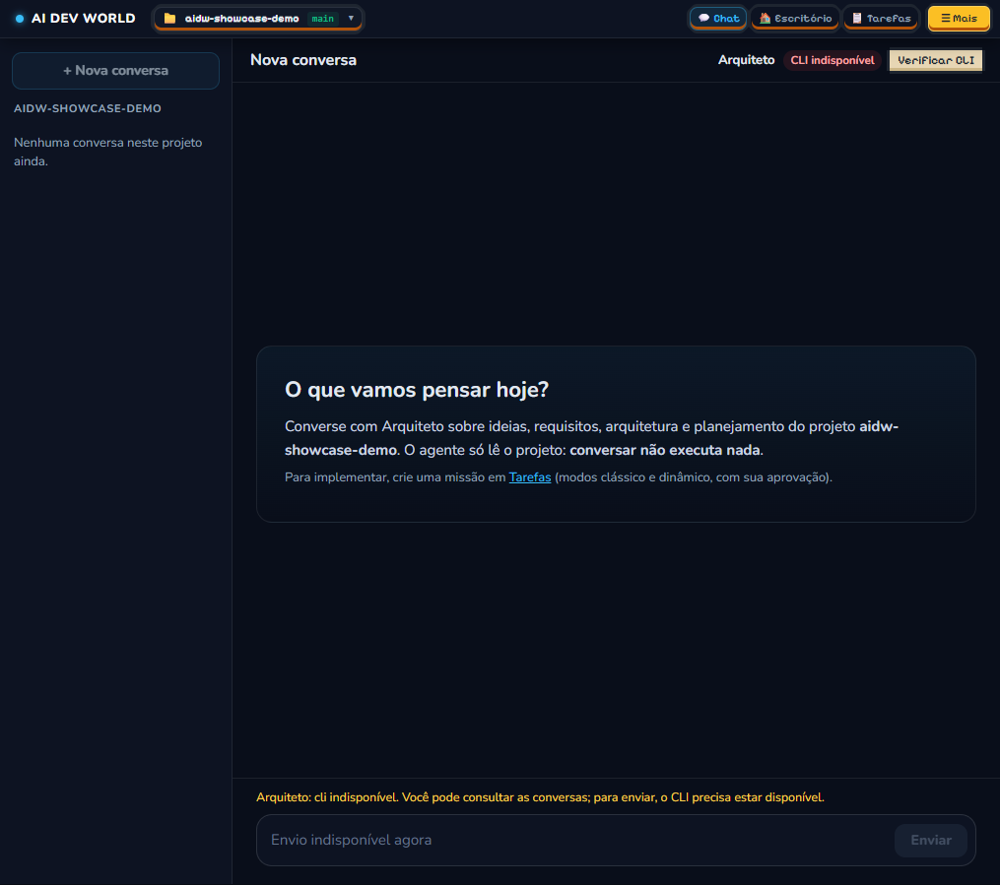
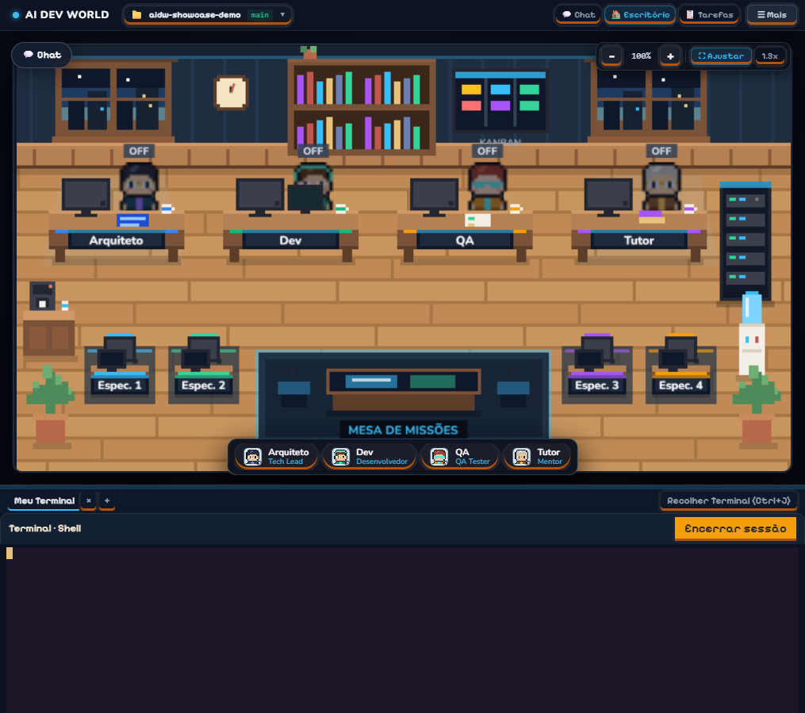
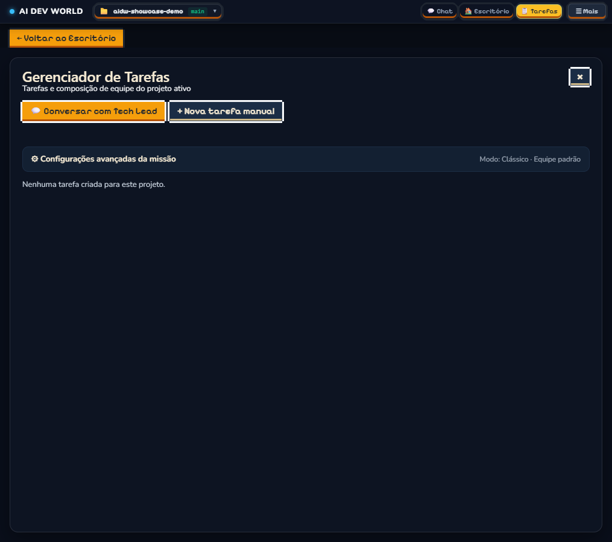
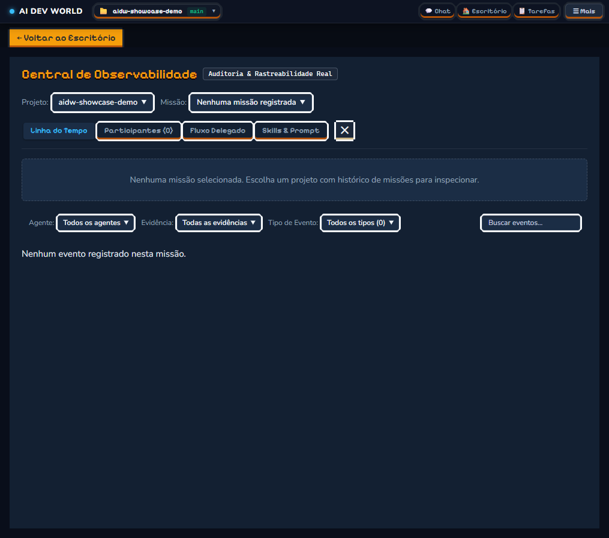
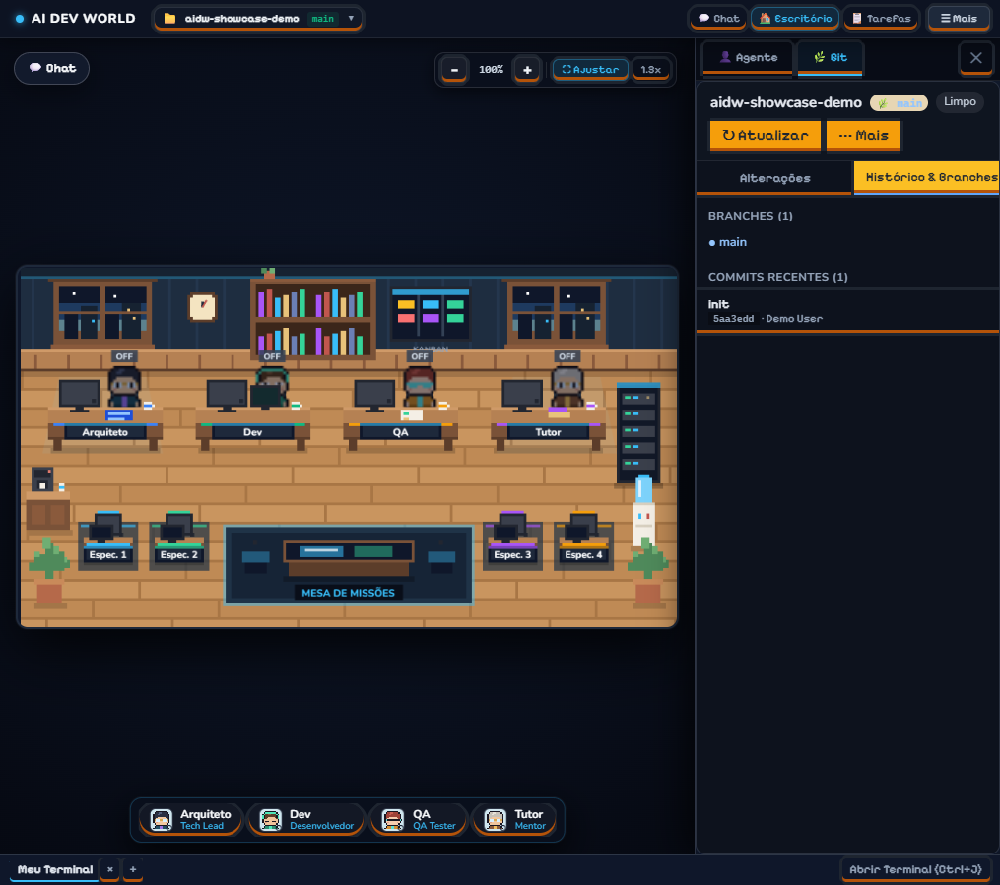

# AI Dev World · Projeto de portfólio

O **AI Dev World** é um aplicativo desktop para coordenar agentes de IA durante o desenvolvimento de software. O problema que motivou o projeto foi acompanhar o que cada agente faz no mesmo repositório e decidir, antes da execução, quais alterações podem ocorrer.

[Versão 1.0.0 para Windows](https://github.com/MoacirSimas-neto/AI-DEV-WORD/releases/tag/v1.0.0) · [README e instruções de execução](../README.md) · [Arquitetura desktop](architecture/TAURI-DESKTOP-ARCHITECTURE.md) · [Modelo de segurança](architecture/DESKTOP-SECURITY-MODEL.md)

## Uma missão na prática

1. **Planejar.** No chat, o usuário discute uma tarefa com o Tech Lead. Ao preparar uma missão, o agente propõe etapas, responsáveis e dependências. O backend valida a proposta.
2. **Decidir.** O usuário aprova, ajusta ou rejeita a proposta. Decisões protegidas exigem confirmação em um diálogo nativo do aplicativo.
3. **Executar.** Os agentes trabalham no repositório ativo via Codex CLI, Gemini CLI ou Antigravity CLI. O escritório mostra o estado de cada agente e o terminal integrado acompanha a execução.
4. **Revisar.** O QA inspeciona o código e as evidências. O usuário pode abrir o diff no painel Git e consultar a trilha de eventos para ver o que o sistema observou e o que o agente relatou.

## Decisões de engenharia

| Decisão | O que resolve |
| --- | --- |
| **Backend local e SQLite** | Mantém a execução e o histórico na máquina. As CLIs usam as sessões e cotas dos respectivos provedores. |
| **Aprovação nativa no Tauri** | Vincula a confirmação do usuário à operação protegida, com um identificador de uso único. |
| **Verificação de alterações com SHA-256** | Detecta mudanças nos arquivos monitorados durante etapas que deveriam ser somente leitura e interrompe a missão quando isso ocorre. |
| **Trilha de eventos por missão** | Distingue evidências observadas pelo sistema, relatos dos agentes e informações indisponíveis. |

A versão 1.0.0 tem instalador Windows x64 sem assinatura digital. O QA faz revisão estática. A execução autônoma de testes reais pelo QA ainda não foi comprovada nessa versão.

## Recursos principais

- **Tech Lead, Developer, QA e Tutor:** papéis separados com permissões por categoria (leitura vs. escrita) e conferência SHA-256 no Git contra alterações fora de passos autorizados. O QA realiza inspeção estática de código e evidências, e a Observabilidade identifica quando os testes não foram executados pelo sistema (`tests.executed: unavailable` / `staticReviewOnly: true`). A execução autônoma de testes reais pelo QA ainda não está comprovada na versão 1.0.
- **Central da Equipe (Agentes, Skills e Memórias):** configuração de provedores/modelos/esforço, criação de avatares pixel art, biblioteca de skills (importação Markdown desativada por padrão) e memória com escopo por projeto ou equipe.
- **Gerenciamento de tarefas e missões:** fluxo a partir do Chat com o Tech Lead (**Preparar missão**) ou criação manual, nos modos **Clássico** e **Dinâmico**, com painel de recuperação após quedas.
- **Terminal integrado (`Ctrl+J`):** sessões PTY reais por agente e abas de shell local no dock inferior.
- **Painel Git:** inspeção de status, diff, staging, histórico de commits e branches no workspace ativo.
- **Observabilidade e histórico:** linha do tempo auditável por missão separando evidências observadas pelo sistema (`observed`), declaradas pelo agente (`declared`) e indisponíveis (`unavailable`).
- **Controle de permissões e segurança:** autenticação por token Bearer/Origin, segredo interno de desktop fora da WebView, consentimento nativo no Tauri, remoção de segredos baseada em padrões nos fluxos PTY/logs e supervisão de processos filhos (Job Object no Windows + guardião).

---

## Arquitetura

| Camada | Tecnologias |
| --- | --- |
| **Desktop Shell** | Tauri 2, Rust, `tauri-plugin-dialog`, Job Object (Windows) |
| **Frontend** | React 19, TypeScript, Vite, Phaser 3, `@xterm/xterm` |
| **Backend Local** | Node.js (sidecar 24.19.0 x64), HTTP + WebSocket (`ws`), `node-pty` |
| **Persistência** | SQLite em modo WAL (`data.sqlite`) |
| **Integrações** | Git CLI e CLIs externas (`codex`, `gemini`, `agy`) |
| **Empacotamento** | Instalador NSIS Windows x64 (`currentUser`, sem assinatura digital) |

---

## Capturas Reais do Aplicativo

Todas as capturas abaixo foram obtidas diretamente da interface real do aplicativo em ambiente isolado (`1015×899`), sem dados pessoais e sem consumo de missões reais:

| Tela | Captura |
| --- | --- |
| **Home / Chat com Tech Lead** |  |
| **Escritório Interativo 2D (Phaser)** |  |
| **Escritório + Terminal Dock (`Ctrl+J`)** |  |
| **Central da Equipe — Agentes** |  |
| **Central da Equipe — Skills** |  |
| **Central da Equipe — Memória** |  |
| **Gerenciador de Tarefas e Missões** |  |
| **Central de Observabilidade** |  |
| **Painel Git (Branches e Histórico)** |  |

---

## Roteiro de Demonstração (3–5 minutos)

1. **Abertura (0:00–0:30):** Abrir o AI Dev World instalado (`AI Dev World_1.0.0_x64-setup.exe`) ou em desenvolvimento (`npm run dev`), selecionar um repositório Git e apresentar o escritório 2D em pixel art.
2. **Central da Equipe (0:30–1:15):** Navegar pelas sub-abas **Agentes** (4 agentes padrão + editor), **Skills** (biblioteca e `+ Adicionar Skill`) e **Memória** (escopo por projeto/equipe com consentimento nativo).
3. **Chat com Tech Lead → Missão (1:15–2:15):** Na aba **Chat**, discutir a tarefa com o Arquiteto e clicar em **Preparar missão** (com confirmação explícita).
4. **Aprovação Humana e Execução (2:15–3:30):** Mostrar a proposta estruturada validada pelo backend (`<<<PROPOSTA ... PROPOSTA>>>`), aprovar via diálogo nativo, acompanhar a execução do Dev e a revisão do QA.
5. **Terminais, Git e Observabilidade (3:30–4:30):** Abrir o **Terminal Dock** (`Ctrl+J`), inspecionar o **Painel Git** e abrir a **Observabilidade** para mostrar a trilha de eventos (`observed` vs. `declared` vs. `unavailable`).

---

## Textos para Portfólio

### GitHub (Descrição Curta)
> Local-first desktop workspace built with Tauri 2, React, TypeScript, Node.js, SQLite, and Phaser to coordinate official AI coding CLIs (Codex, Gemini, Antigravity) under native human-in-the-loop consent, process supervision, and SHA-256 file integrity checks.

### Currículo
> **AI Dev World (v1.0.0)** — Aplicação desktop local-first (Tauri 2 / Rust, Node.js sidecar, SQLite WAL, React, TypeScript, Phaser 3, WebSocket e `node-pty`) para orquestração supervisionada de múltiplos agentes via CLIs oficiais, com consentimento humano nativo por nonce único, validação estrita de propostas, conferência SHA-256 contra escritas não autorizadas, supervisão de árvore de processos e painel de observabilidade.

### Pitch de Entrevista (~1 minuto)
> "Criei o AI Dev World para coordenar múltiplos agentes de IA no meu próprio repositório usando as CLIs oficiais que já tenho autenticadas na máquina, sem perder controle do que cada agente altera. Estruturei um shell desktop em Tauri 2 e Rust que gerencia um sidecar Node.js local com banco SQLite em modo WAL e frontend React + Phaser via WebSocket e terminais PTY reais. O ponto central de engenharia foi tratar toda saída de modelo como dado não confiável: o backend valida o schema das propostas, bloqueia escritas fora de passos aprovados com hashes SHA-256 no Git, exige confirmação nativa no Tauri com nonce único para decisões críticas e supervisiona toda a árvore de processos filhos."
