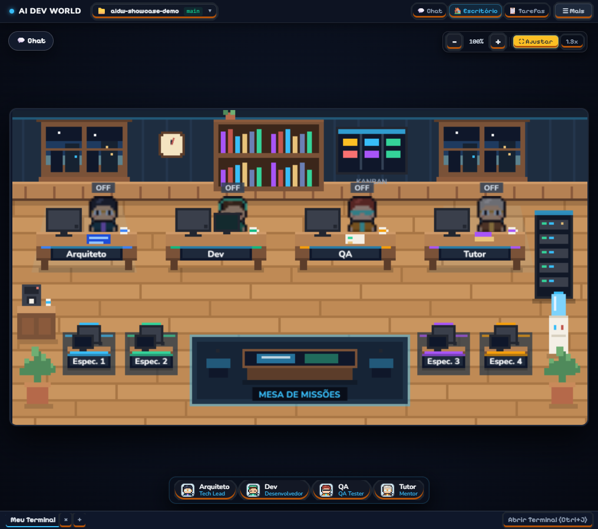
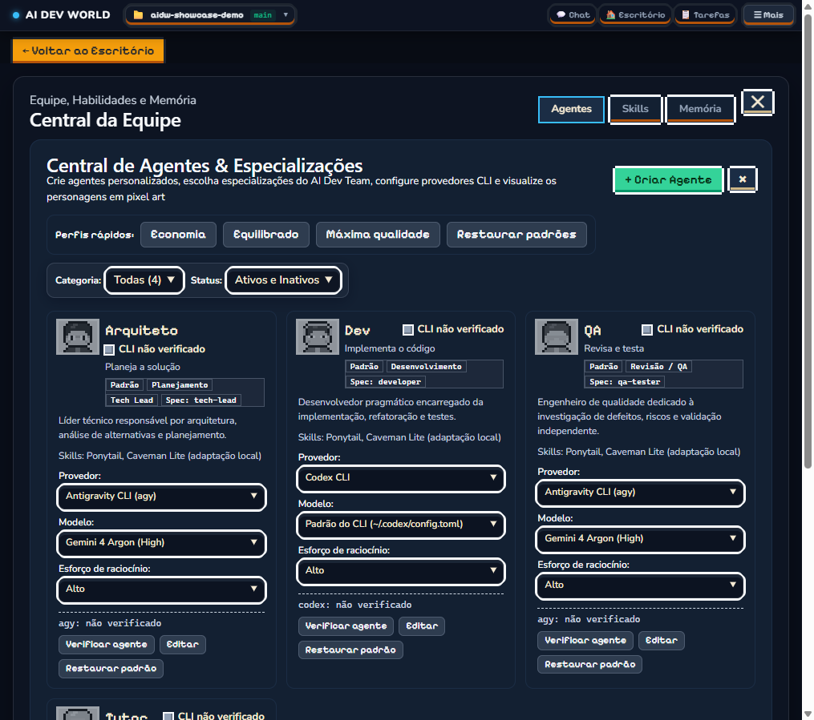
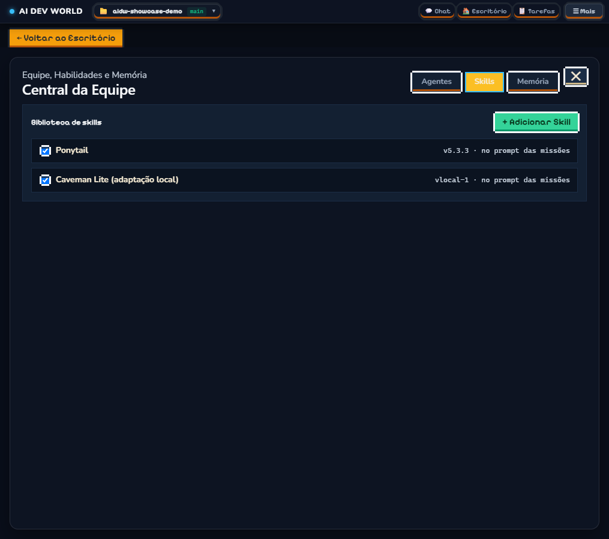
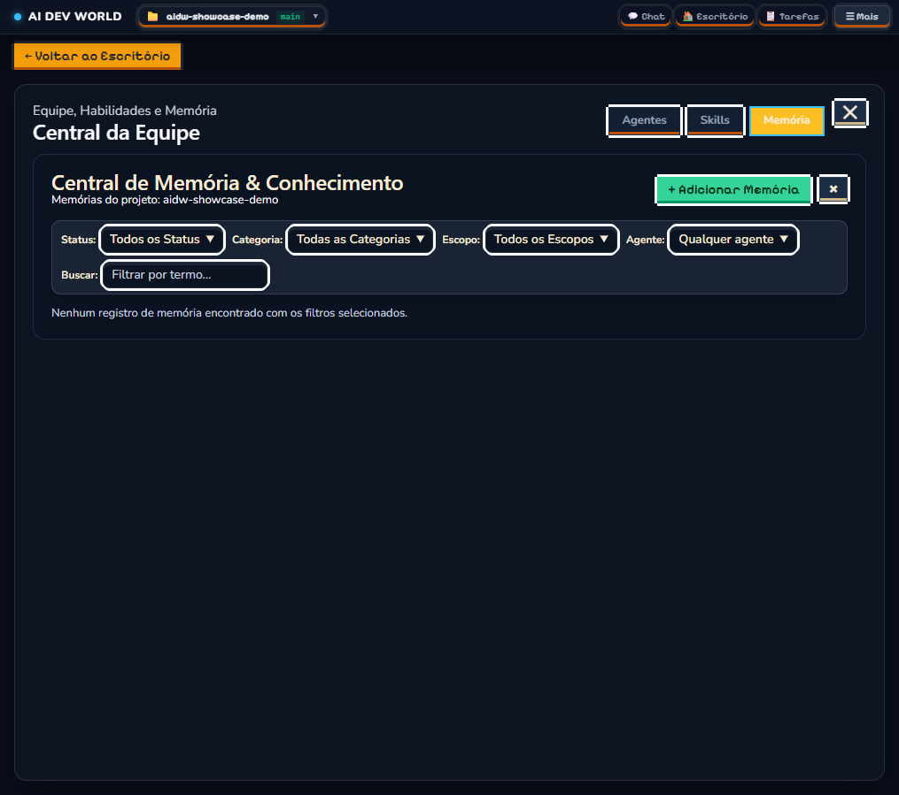

# AI Dev World (v1.0.0) — Showcase & Portfólio

## O projeto

**AI Dev World** é um aplicativo desktop **local-first** para desenvolvimento supervisionado por agentes de IA. Em vez de substituir o desenvolvedor ou depender de APIs proprietárias extras, ele transforma um escritório 2D interativo em uma estação de trabalho onde uma equipe de especialistas colabora via **CLIs oficiais já instalados e autenticados pelo usuário** (`codex`, `gemini` e `agy`), sempre sob **aprovações humanas verificáveis**.

- **Escritório interativo (Phaser 3):** acompanhamento visual do estado de cada agente (planejando, executando, revisando, aguardando decisão), dock de atalhos e objetos clicáveis.
- **Equipe de especialistas:** **Arquiteto** (Tech Lead), **Dev** (Developer), **QA** (revisão de código e evidências) e **Tutor**, além de agentes personalizados com especializações em Markdown.
- **Delegação e orquestração dinâmica:** o Tech Lead propõe equipe, passos e dependências em formato estruturado (`<<<PROPOSTA ... PROPOSTA>>>`) validado estritamente pelo backend antes de ir para decisão humana.
- **Aprovações humanas nativas:** decisões de missão (`proposal-decide`, `mission-close`) e aprovações de memória (`memory-approve`) exigem confirmação em diálogo nativo do Tauri com nonce criptográfico de uso único vinculado à operação.
- **Integração com CLIs reais:** execução headless supervisionada e terminais PTY reais (`node-pty`) no diretório do repositório ativo. O uso dos modelos depende das contas, cotas e condições de cada provedor.

---

## Recursos principais

- **Tech Lead, Developer, QA e Tutor:** papéis separados com permissões por categoria (leitura vs. escrita) e conferência SHA-256 no Git contra alterações fora de passos autorizados. O QA realiza inspeção estática de código e evidências, e a Observabilidade identifica quando os testes não foram executados pelo sistema (`tests.executed: unavailable` / `staticReviewOnly: true`). A execução autônoma de testes reais pelo QA ainda não está comprovada na versão 1.0.
- **Central da Equipe (Agentes, Skills e Memórias):** configuração de provedores/modelos/esforço, criação de avatares pixel art, biblioteca de skills (importação Markdown desativada por padrão) e memória com escopo por projeto ou equipe.
- **Gerenciamento de tarefas e missões:** fluxo a partir do Chat com o Tech Lead (**Preparar missão**) ou criação manual, nos modos **Clássico** e **Dinâmico**, com painel de recuperação após quedas.
- **Terminal integrado (`Ctrl+J`):** sessões PTY reais por agente e abas de shell local no dock inferior.
- **Painel Git:** inspeção de status, diff, staging, histórico de commits e branches no workspace ativo.
- **Observabilidade e histórico:** linha do tempo auditável por missão separando evidências observadas pelo sistema (`observed`), declaradas pelo agente (`declared`) e indisponíveis (`unavailable`).
- **Controle de permissões e segurança:** autenticação por token Bearer/Origin, segredo interno de desktop fora da WebView, consentimento nativo no Tauri, remoção de segredos baseada em padrões nos fluxos PTY/logs e supervisão de processos filhos (Job Object no Windows + guardião).

---

## Arquitetura

| Camada | Tecnologias |
| --- | --- |
| **Desktop Shell** | Tauri 2, Rust, `tauri-plugin-dialog`, Job Object (Windows) |
| **Frontend** | React 19, TypeScript, Vite, Phaser 3, `@xterm/xterm` |
| **Backend Local** | Node.js (sidecar 24.19.0 x64), HTTP + WebSocket (`ws`), `node-pty` |
| **Persistência** | SQLite em modo WAL (`data.sqlite`) |
| **Integrações** | Git CLI e CLIs externas (`codex`, `gemini`, `agy`) |
| **Empacotamento** | Instalador NSIS Windows x64 (`currentUser`, sem assinatura digital) |

---

## Capturas Reais do Aplicativo

Todas as capturas abaixo foram obtidas diretamente da interface real do aplicativo em ambiente isolado (`1015×899`), sem dados pessoais e sem consumo de missões reais:

| Tela | Captura |
| --- | --- |
| **Home / Chat com Tech Lead** |  |
| **Escritório Interativo 2D (Phaser)** |  |
| **Escritório + Terminal Dock (`Ctrl+J`)** |  |
| **Central da Equipe — Agentes** |  |
| **Central da Equipe — Skills** |  |
| **Central da Equipe — Memória** |  |
| **Gerenciador de Tarefas e Missões** |  |
| **Central de Observabilidade** |  |
| **Painel Git (Branches e Histórico)** |  |

---

## Roteiro de Demonstração (3–5 minutos)

1. **Abertura (0:00–0:30):** Abrir o AI Dev World instalado (`AI Dev World_1.0.0_x64-setup.exe`) ou em desenvolvimento (`npm run dev`), selecionar um repositório Git e apresentar o escritório 2D em pixel art.
2. **Central da Equipe (0:30–1:15):** Navegar pelas sub-abas **Agentes** (4 agentes padrão + editor), **Skills** (biblioteca e `+ Adicionar Skill`) e **Memória** (escopo por projeto/equipe com consentimento nativo).
3. **Chat com Tech Lead → Missão (1:15–2:15):** Na aba **Chat**, discutir a tarefa com o Arquiteto e clicar em **Preparar missão** (com confirmação explícita).
4. **Aprovação Humana e Execução (2:15–3:30):** Mostrar a proposta estruturada validada pelo backend (`<<<PROPOSTA ... PROPOSTA>>>`), aprovar via diálogo nativo, acompanhar a execução do Dev e a revisão do QA.
5. **Terminais, Git e Observabilidade (3:30–4:30):** Abrir o **Terminal Dock** (`Ctrl+J`), inspecionar o **Painel Git** e abrir a **Observabilidade** para mostrar a trilha de eventos (`observed` vs. `declared` vs. `unavailable`).

---

## Textos para Portfólio

### GitHub (Descrição Curta)
> Local-first desktop workspace built with Tauri 2, React, TypeScript, Node.js, SQLite, and Phaser to coordinate official AI coding CLIs (Codex, Gemini, Antigravity) under native human-in-the-loop consent, process supervision, and SHA-256 file integrity checks.

### Currículo
> **AI Dev World (v1.0.0)** — Aplicação desktop local-first (Tauri 2 / Rust, Node.js sidecar, SQLite WAL, React, TypeScript, Phaser 3, WebSocket e `node-pty`) para orquestração supervisionada de múltiplos agentes via CLIs oficiais, com consentimento humano nativo por nonce único, validação estrita de propostas, conferência SHA-256 contra escritas não autorizadas, supervisão de árvore de processos e painel de observabilidade.

### Pitch de Entrevista (~1 minuto)
> "Criei o AI Dev World para coordenar múltiplos agentes de IA no meu próprio repositório usando as CLIs oficiais que já tenho autenticadas na máquina, sem perder controle do que cada agente altera. Estruturei um shell desktop em Tauri 2 e Rust que gerencia um sidecar Node.js local com banco SQLite em modo WAL e frontend React + Phaser via WebSocket e terminais PTY reais. O ponto central de engenharia foi tratar toda saída de modelo como dado não confiável: o backend valida o schema das propostas, bloqueia escritas fora de passos aprovados com hashes SHA-256 no Git, exige confirmação nativa no Tauri com nonce único para decisões críticas e supervisiona toda a árvore de processos filhos."
